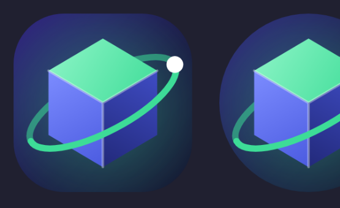
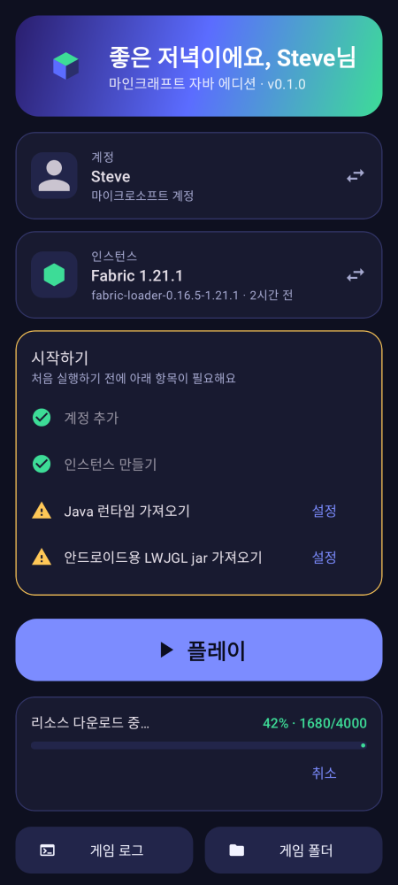
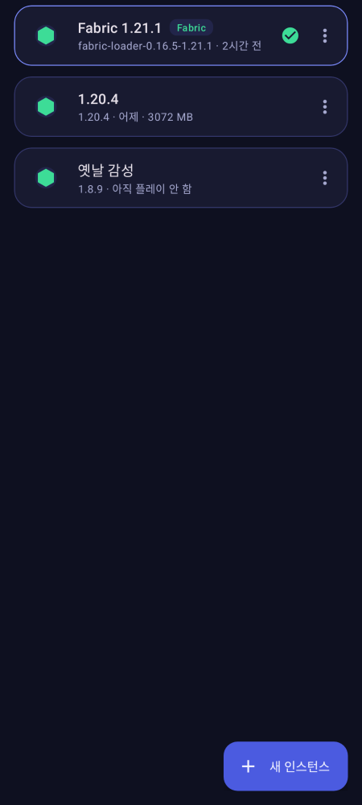
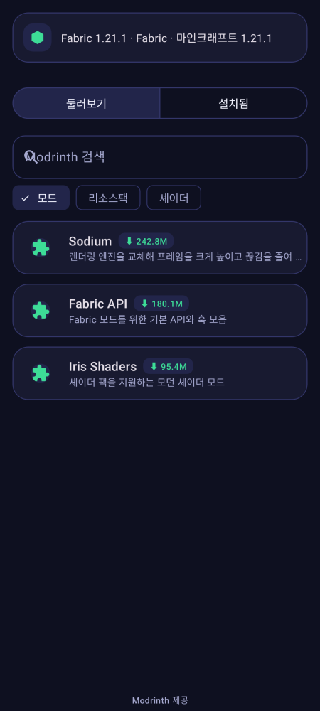

# QuantuMobileLauncher

<p align="center"></p>

안드로이드용 **마인크래프트 자바 에디션** 런처입니다. PojavLauncher / MojoLauncher 와 같은 방식으로,
안드로이드용으로 빌드된 OpenJDK 를 앱 프로세스 안에서 직접 실행해 게임을 구동합니다.

<p align="center">
  
  
  
</p>

## 기능

| 기능 | 상태 |
| --- | --- |
| 마이크로소프트 로그인 (Xbox Live → XSTS → Minecraft 서비스, 토큰 자동 갱신) | ✅ |
| 오프라인 계정 (바닐라 서버와 같은 UUID 생성) | ✅ |
| 모장 버전 목록 / 릴리스·스냅샷 | ✅ |
| 클라이언트 jar, 라이브러리, 에셋 병렬 다운로드 + SHA-1 검증 + 재시도 | ✅ |
| 1.6 이전 버전의 legacy/virtual 에셋 | ✅ |
| `inheritsFrom` 프로필 병합 (Fabric, 직접 추가한 Forge/Quilt 프로필 등) | ✅ |
| Fabric 원클릭 설치 (공식 meta API) | ✅ |
| 인스턴스 (버전별 분리된 게임 폴더, 메모리/JVM 인자 개별 설정) | ✅ |
| 실행 인자 생성 (신규 `arguments` 포맷 + 구버전 `minecraftArguments`, rule 평가) | ✅ |
| 필요한 Java 버전 자동 선택 (8 / 17 / 21) | ✅ |
| Java 런타임 가져오기 (`.tar.xz` / `.tar.gz`) | ✅ |
| **LWJGL 자동 설치** (안드로이드용 LWJGL 3, 앱을 켤 때 미리 받음) | ✅ |
| **Java 런타임 자동 다운로드**: 게임에 필요한 Java 가 없으면 시작 전에 알아서 받아서 설치 (Java 17 / 21 / 25, arm64·arm32·x86_64) | ✅ |
| 앱 안에서 Java 런타임 다운로드 (카탈로그 선택 또는 링크 입력, SHA-256 검증, 진행률) | ✅ |
| 필요한 Java 가 없을 때 오류 창에서 바로 "Java N 받기" | ✅ |
| JNI 브릿지: `JLI_Launch` 로 JVM 실행, stdout/stderr → 로그 파일 | ✅ |
| 터치 컨트롤 (이동 패드, 점프/웅크리기/달리기, 공격/사용, 단축키, 핫바 스크롤) | ✅ |
| 화면 드래그로 시점 조작, 탭 = 사용, 길게 누르기 = 부수기, 메뉴에서는 마우스 포인터 | ✅ |
| 물리 키보드 / 마우스 (포인터 캡처), 소프트 키보드로 채팅 입력 | ✅ |
| 해상도 배율, GL4ES 렌더러 | ✅ |
| 한국어 / 영어 UI, 다크 테마 | ✅ |
| 홈에서 계정·인스턴스 바로 전환, 스킨 아바타 표시 | ✅ |
| **원클릭 다운로드**: 모드·리소스팩·셰이더 목록 오른쪽 끝의 다운로드 버튼을 누르면 확인 없이 바로 백그라운드로 설치(의존성 포함). 이미 받은 항목은 [켜기/끄기] [제거] 버튼 (모드는 `.disabled` 로 이름 변경, 리소스팩·셰이더는 게임 설정에 반영) | ✅ |
| **조작 사용자 지정**: 설정 → "조작 사용자 지정" 에서 게임을 켜지 않고 화면 버튼을 끌어 옮기고, 키·크기·이름·토글을 바꾸고, 버튼 추가/삭제/초기화 | ✅ |
| **비주얼 탭**: 리소스팩·셰이더 — 기기에서 .zip 추가, Modrinth 에서 다운로드, 켜기/끄기·우선순위(`options.txt`), 셰이더 선택(Iris `iris.properties` / OptiFine). 셰이더는 Iris 모드가 필요 | ✅ |
| **백그라운드 동작**: 설치·다운로드가 앱을 나가도 계속되고(진행 알림), 끝나면 알림, 게임은 홈 화면으로 나가도 계속 실행 (알림에서 복귀/종료) | ✅ |
| 처음 실행 체크리스트 (빠진 설정으로 바로 이동) | ✅ |
| 검색·필터 가능한 버전 선택 (정식/스냅샷/알파·베타/설치됨) | ✅ |
| **Modrinth 연동**: 모드·리소스팩·셰이더 검색/설치/삭제/업데이트, 선택한 인스턴스의 버전·로더에 맞는 것만 표시, 필수 의존성(Fabric API 등) 자동 설치, SHA-1 검증 | ✅ |
| 인스턴스 메뉴 (바로 플레이, 이름 변경, 메모리, JVM 인자), 최근 플레이 순 정렬 | ✅ |
| 로그 색상 강조 (오류/경고), 로그 복사·공유 | ✅ |

## 자동으로 받아지는 것

플레이를 누르면 (그리고 앱을 처음 켤 때 미리) 필요한 것을 **알아서 받아서 설치**합니다. 모두 SHA-256 으로 검증합니다.

| 구성 요소 | 내용 | 설정에서 끄기 |
| --- | --- | --- |
| 게임 파일 | 클라이언트, 라이브러리, 에셋 (모장) | — |
| **Java 런타임** | 안드로이드용 OpenJDK 17 / 21 / 25 (필요한 버전을 자동 선택) | "Java 자동 다운로드" |
| **LWJGL** | 안드로이드용 LWJGL 3 (GLFW 포함 jar 1개 + ABI별 네이티브 9개, 약 20 MB) | "LWJGL 자동 설치" |
| 모드 로더 | Fabric (인스턴스를 만들 때) | — |

- **LWJGL** 은 [PojavLauncher](https://github.com/PojavLauncherTeam/PojavLauncher) (LGPL-3.0, 2025-09 개발 중단) 의 빌드를 특정 커밋에 고정해서 받습니다.
  모장의 데스크톱용 LWJGL 은 x86/glibc 용이라 안드로이드에서 로드되지 않으므로 이 jar 로 교체합니다. 홈의 "시작하기" 체크리스트나
  설정의 "안드로이드용 LWJGL 설치"에서 직접 받을 수도 있고, 직접 가져온 jar 도 쓸 수 있습니다. 목록은 [`lwjgl.json`](app/src/main/assets/lwjgl.json) 입니다.

### 업데이트해도 데이터가 남는 방법

계정·인스턴스·Java 런타임·다운로드한 모드/팩은 앱 전용 저장소에 있어서, **같은 키로 서명된 APK 위에 덮어서 설치(업데이트)하면 그대로 남습니다.**
같은 키로 서명하려면 환경변수 `QML_KEYSTORE`(.jks 경로), `QML_KEYSTORE_PASSWORD`, `QML_KEY_ALIAS`, `QML_KEY_PASSWORD` 를 설정하고 빌드하세요
(CI 는 GitHub Secrets 에서 넘기도록 설정해야 하며, 키 파일 자체는 저장소에 올리지 않습니다). 설정이 없으면 빌드마다 다른 디버그 키로 서명되어
업데이트가 거부될 수 있고, 그러면 삭제 후 재설치해야 해서 데이터가 사라집니다. **앱을 삭제하면 데이터도 같이 지워지니 덮어서 설치하세요.**

### 화면·입력 네이티브 브릿지 (`libpojavexec`)

LWJGL jar 의 `GLFW` 클래스가 로드하는 **`pojavexec`** 는 PojavLauncher 의 네이티브 코드를 이식한 것입니다
([`app/src/main/cpp/pojav`](app/src/main/cpp/pojav), 출처·변경점·LGPL-3.0 고지는 [`third_party/pojavlauncher`](third_party/pojavlauncher/NOTICE.md)).
안드로이드 `Surface` → EGL/GL4ES, 터치·키 입력 → GLFW 콜백, JVM 실행(`JLI_Launch`)을 맡습니다.
Kotlin 쪽에는 이 네이티브 코드가 요구하는 이름의 클래스(`org.lwjgl.glfw.CallbackBridge`, `net.kdt.pojavlaunch.utils.JREUtils`,
`com.oracle.dalvik.VMLauncher`)가 있고, 시작 순서(`JvmStarter`)는 Pojav 와 같습니다: 화면 크기 전달 → 창 연결 → 환경변수·라이브러리 경로 → JVM 시작.

> ⚠️ **실기기 검증 전입니다.** 컴파일·단위 테스트·린트까지만 확인했고, 실제 기기에서 화면이 뜨는지는 아직 확인하지 못했습니다.
> 안 뜨면 홈 → 게임 로그를 공유해 주세요. 렌더러는 GL4ES 만 지원합니다 (Zink/Vulkan, AWT 가 필요한 모드는 미지원).

### Java 런타임 (자동 다운로드)

플레이를 누르면 런처가 필요한 Java 버전을 확인하고, 없으면 **자동으로 받아서 설치한 뒤** 게임을 시작합니다
(설정 → "Java 자동 다운로드" 로 끌 수 있습니다). 직접 고르고 싶으면 설정의 **Java 런타임 다운로드** 를 쓰세요.

- **기본 카탈로그**: 앱에 내장된 [`runtimes.json`](app/src/main/assets/runtimes.json) — [ZalithLauncher](https://github.com/ZalithLauncher/ZalithLauncher)
  프로젝트가 배포하는 안드로이드용 OpenJDK **17 / 21 / 25** (arm64-v8a, armeabi-v7a, x86_64, Java 25 는 x86 제외).
  각 런타임은 "공통 부분 + CPU별 부분" 두 파일로 나뉘어 있고, 받아서 한 폴더에 합쳐 풉니다.
  주소는 특정 커밋에 고정되어 있고 모든 파일을 SHA-256 으로 검증합니다 (OpenJDK 는 GPLv2 + Classpath Exception).
- **기기에 맞는 것만**: CPU(ABI)에 맞는 항목만 보여주고, 필요한 버전이 정확히 있으면 그것을, 없으면 그보다 높은 가장 낮은 버전을 고릅니다.
- **직접 만든 목록**: 설정의 "런타임 목록 주소"에 https 주소를 넣으면 내장 목록 대신 그 목록을 씁니다.
  형식은 `{"runtimes":[{"name","java","abi","parts":[{"url","sha256","size"}],"sizeMb"}]}` 입니다 (파일 하나면 `url`/`sha256` 만 써도 됩니다).
- 목록에 없는 런타임은 **링크 입력** 으로 직접 받을 수 있습니다.
- ⚠️ **Java 8 은 아직 지원하지 않습니다.** Java 8 런타임의 라이브러리는 Pack200 으로 압축돼 있고(`rt.jar.pack` 등), 이를 풀려면
  OpenJDK 의 네이티브 `unpack200` 이 필요합니다 (Pojav 계열 런처는 앱에 `libunpack200.so` 를 넣어 둡니다). 아직 이 앱에는 없어서
  Java 8 이 필요한 구버전(1.16.5 이하)은 자동으로 더 높은 Java 로 실행을 시도하며, 오래된 버전은 실패할 수 있습니다.
  Java 8 런타임을 직접 가져오면 이유를 설명하는 오류가 납니다.

위 파일들은 대부분 LGPL/GPL 계열 라이선스이므로, 함께 배포할 때는 각 라이선스를 지켜야 합니다.

## 구조

```
app/src/main/java/com/quantumobile/launcher/
├── core/
│   ├── auth/       계정 모델·저장소, 마이크로소프트 인증
│   ├── mc/         버전 매니페스트, 버전 JSON 병합, rule, 라이브러리, 에셋, 설치, 실행 인자, Fabric
│   ├── net/        OkHttp 래퍼, 병렬 다운로더(SHA-1 검증)
│   ├── runtime/    Java 런타임 설치/선택
│   ├── instance/   인스턴스
│   └── LaunchPreparer.kt   로그인 갱신 → 설치 → 런타임 선택 → 명령줄 생성
├── game/           GameActivity(:game 프로세스), 터치 컨트롤, 키 매핑, JNI 바인딩
└── ui/             홈/계정/인스턴스/설정 화면, MS 로그인 WebView, 로그 뷰어
app/src/main/cpp/
├── jvm_launcher.c  JRE 라이브러리 미리 로드 + JLI_Launch 호출
├── input_bridge.c  Surface/입력 이벤트 큐 (GLFW 구현체가 폴링)
└── qml_bridge.h    네이티브 ABI
```

게임은 별도 프로세스(`:game`)에서 실행됩니다. JVM 이 시작되면 프로세스를 점유하고, 게임 종료 시 `System.exit` 로 프로세스가 끝나기 때문입니다.

게임 파일 위치: `Android/data/com.quantumobile.launcher/files/.minecraft` (파일 관리자로 모드/리소스팩 추가 가능)

## 빌드

Android SDK (compileSdk 35), NDK 27.2, CMake 3.22.1, JDK 17 이상이 필요합니다.

```bash
./gradlew assembleDebug          # app/build/outputs/apk/debug/app-debug.apk
./gradlew testDebugUnitTest      # 단위 테스트
QML_NETWORK_TESTS=1 ./gradlew testDebugUnitTest   # 실제 모장/Fabric 서버를 사용하는 테스트 포함
```

GitHub Actions 가 푸시마다 테스트, lint, APK 빌드를 수행하고 APK 를 아티팩트로 올립니다.

## 참고

- 마이크로소프트 로그인은 대부분의 서드파티 런처가 쓰는 공개 Live 클라이언트 ID(`00000000402b5328`)를 사용합니다.
- 계정 토큰은 앱 내부 저장소(`files/accounts.json`)에 저장되며 다른 앱은 읽을 수 없습니다.
- 마인크래프트는 Mojang/Microsoft 의 상표이며, 이 프로젝트는 공식 제품이 아닙니다. 정품 계정으로 플레이하세요.
