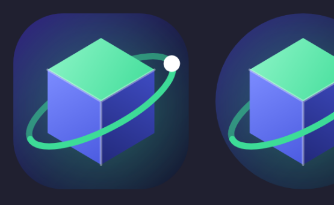
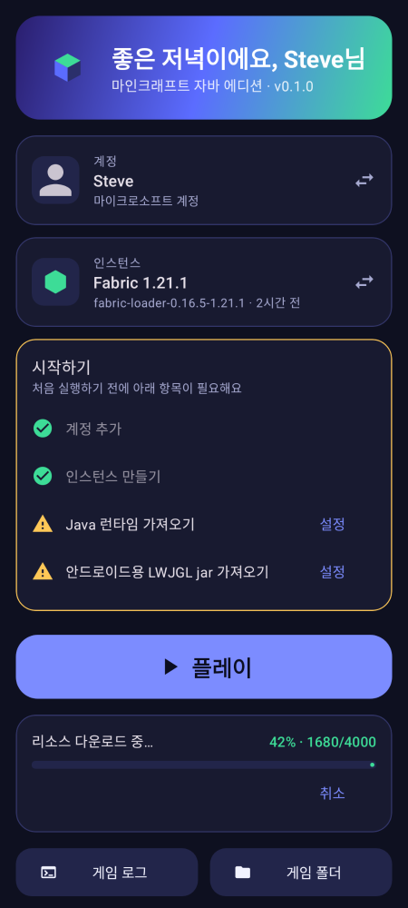
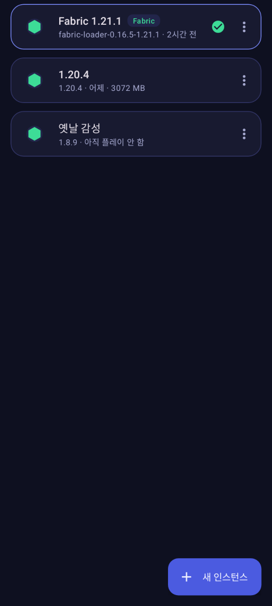
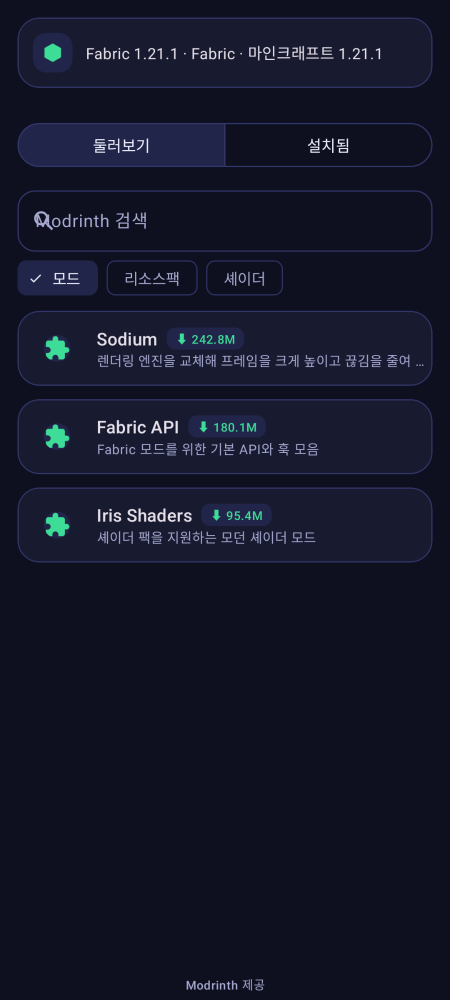

# QuantuMobileLauncher

<p align="center"></p>

[](https://github.com/qmftm/QuantuMobileLauncher/actions/workflows/android.yml)
[](https://github.com/qmftm/QuantuMobileLauncher/releases/latest)
[](https://github.com/qmftm/QuantuMobileLauncher/commits)

*[Boardwalk](https://github.com/AndroidPojavLauncherTeam/boardwalk) 와 [PojavLauncher](https://github.com/PojavLauncherTeam/PojavLauncher) 의 뒤를 잇는 또 하나의 안드로이드용 마인크래프트 런처, 여기 QuantuMobileLauncher 입니다!*

QuantuMobileLauncher 는 안드로이드에서 **마인크래프트: 자바 에디션**을 플레이하게 해 주는 런처입니다.
안드로이드용으로 빌드된 OpenJDK 를 앱 프로세스 안에서 직접 실행하는 방식이고, 최신 **26.x (SDL3)** 까지 겨냥합니다.

<p align="center">
  
  
  
</p>

## 목차

- [소개](#소개)
- [받기](#받기)
- [빌드하기](#빌드하기)
  - [빠른 빌드](#빠른-빌드-권장)
  - [자세한 빌드](#자세한-빌드)
- [현재 상태](#현재-상태)
- [알려진 문제](#알려진-문제)
- [FAQ](#faq)
- [기여하기](#기여하기)
- [라이선스](#라이선스)
- [크레딧과 의존성](#크레딧과-의존성)
- [로드맵](#로드맵)

## 소개

- 마인크래프트 **1.21.x 이하**는 LWJGL 3.3 + GLFW 창(PojavLauncher 방식), **26.x** 는 SDL3 + LWJGL 3.4.3 + MobileGlues 경로로 실행합니다.
- 마이크로소프트 로그인과 오프라인 계정을 지원합니다.
- Fabric 을 원클릭으로 설치하고, Forge/Quilt 같은 프로필도 `inheritsFrom` 병합으로 직접 추가할 수 있습니다.
- **AFK(잠수) 봇**: 게임을 켜지 않고 서버에 접속만 해 두고, PC에서 대신 돌릴 수도 있습니다 ([아래](#afk를-pc에서-돌리기)).
- Modrinth 에서 모드·리소스팩·셰이더를 검색하고 한 번에 설치합니다 (**다운로드** 탭).
- 버튼 배치를 직접 꾸미는 터치 조작판과, 물리 키보드/마우스를 지원합니다.
- 필요한 Java 와 LWJGL 은 처음 켤 때 알아서 받습니다.

## 받기

1. **미리 빌드된 APK 받기 (권장)**
   [Releases](https://github.com/qmftm/QuantuMobileLauncher/releases/latest) 에서 기기에 맞는 APK 를 받아 설치합니다.
   모든 릴리즈는 같은 키로 서명되므로 **덮어서 설치(업데이트)하면 계정·인스턴스·모드가 그대로 남습니다.**
2. **직접 빌드하기**
   아래 [빌드하기](#빌드하기)를 따라 하세요.

> 같은 키를 쓰기 전 버전을 쓰고 있었다면 처음 한 번만 **삭제 후 재설치**가 필요합니다 (데이터도 같이 지워집니다).

## 빌드하기

Android SDK (compileSdk 35), NDK 27.2, CMake 3.22.1, JDK 17 이상이 필요합니다.

### 빠른 빌드 (권장)

```bash
git clone https://github.com/qmftm/QuantuMobileLauncher.git
cd QuantuMobileLauncher
./gradlew assembleDebug          # app/build/outputs/apk/debug/app-debug.apk
```

테스트와 린트:

```bash
./gradlew testDebugUnitTest :app:lintDebug
QML_NETWORK_TESTS=1 ./gradlew testDebugUnitTest   # 실제 모장/Fabric 서버를 쓰는 테스트 포함
```

GitHub Actions 가 푸시마다 테스트, lint, APK 빌드를 수행합니다.

### 자세한 빌드

26.x 용 네이티브(SDL3, LWJGL 3.4.3, MobileGlues 등)는 이미 빌드된 결과물이 저장소에 들어 있어서 보통은 다시 빌드할 필요가 없습니다.
직접 다시 만들고 싶다면 [`third_party/natives`](third_party/natives) 의 스크립트를 쓰세요.

1. `build-sdl3-android.sh` — SDL3 (이 프로젝트의 패치 [`sdl3-android-quantumobile.patch`](third_party/natives/patches/sdl3-android-quantumobile.patch) 적용)
2. `build-lwjgl-android.sh` — 안드로이드용 LWJGL 3.4.3
3. `build-mobileglues-android.sh` — OpenGL → GLES 변환 (MobileGlues)
4. `build-shaderc-android.sh`, `build-spirv-cross-android.sh` — 셰이더 도구
5. 앱 빌드: `./gradlew assembleDebug`

서명 키는 저장소의 [`app/signing/quantumobile-release.jks`](app/signing/quantumobile-release.jks) 입니다.
**스토어 배포용이 아니라 일부러 공개 저장소에 포함한 키**이니, 신뢰가 필요하면 환경변수
`QML_KEYSTORE`, `QML_KEYSTORE_PASSWORD`, `QML_KEY_ALIAS`, `QML_KEY_PASSWORD` 로 다른 키를 지정하세요.

## 현재 상태

- [x] 마이크로소프트 로그인 (Xbox Live → XSTS → Minecraft 서비스, 토큰 자동 갱신), 오프라인 계정
- [x] 모장 버전 목록 (릴리스/스냅샷/알파·베타), 병렬 다운로드 + SHA-1 검증, legacy 에셋
- [x] 인스턴스 (버전별 폴더, 메모리/JVM 인자 개별 설정)
- [x] Java 17 / 21 / 25 자동 선택·자동 다운로드 (arm64-v8a, armeabi-v7a, x86_64, SHA-256 검증)
- [x] 안드로이드용 LWJGL 자동 설치
- [x] 1.21.x 이하: LWJGL 3.3 + GLFW, GL4ES 렌더러
- [x] 26.x: SDL3 + LWJGL 3.4.3 + MobileGlues (실험 단계)
- [x] 터치 조작판: 이동 패드, 점프/웅크리기, 공격/사용, 단축키, 핫바 스크롤, 꾹 누르면 반복, GUI 숨김, 마우스 포인터 모드
- [x] 조작 사용자 지정: 게임을 켜지 않고 버튼을 끌어 옮기고 키·크기·이름·반복을 바꾸기
- [x] 뒤로가기 = Esc, 소프트 키보드 입력, 물리 키보드/마우스
- [x] 서버 접속 (SRV 레코드 조회를 안드로이드 DNS 로 처리하는 자바 에이전트 포함)
- [x] **다운로드 탭**: Modrinth 의 모드·리소스팩·셰이더 검색, 원클릭 설치(필수 의존성 포함), 켜기/끄기/제거, 업데이트 확인, 기기에서 .zip 추가
- [x] **AFK 봇** (실험): 서버별 ON/OFF, 20~45초마다 웅크리기, 끊기면 자동 재접속, 재부팅 후 자동 시작, 1.20.2 ~ 26.3 서버, PC에서 실행
- [x] 백그라운드 설치/다운로드 (진행 알림), 게임은 홈으로 나가도 계속 실행
- [x] 한국어 / 영어 UI, 다크 테마, 로그 보기·공유
- [ ] Java 8 (Pack200 `unpack200` 필요 → 1.16.5 이하는 더 높은 Java 로 시도하며 실패할 수 있음)
- [ ] Vulkan(Zink), Sodium, Iris 를 26.x 에서 쓰기
- [ ] AWT 가 필요한 모드
- [ ] 아이폰 (보류)

> ⚠️ 실기기 검증은 한정적입니다. 개발자가 쓰는 기기(Galaxy Z Flip6, Adreno 750) 위주로 확인하며, 다른 기기에서는 동작이 다를 수 있습니다.

## AFK를 PC에서 돌리기

서버마다 "실행 위치"를 **이 폰** 또는 **PC**로 고를 수 있습니다. PC에서 돌리면 폰을 꺼도 계속 접속해 있고, 앱은 리모컨처럼 켜기·끄기·상태 보기만 합니다.

1. 릴리스 페이지에서 `QuantuMobileLauncher-AFK-Host.jar` 를 받습니다. (Java 17 이상 필요)
2. PC에서 실행: `java -jar QuantuMobileLauncher-AFK-Host.jar`
   - 창에 **주소**(예: `192.168.0.12:25580`)와 **연결 코드**(예: `ABCD-EFGH-JKLM`)가 나옵니다.
   - 옵션: `--port 25580`, `--name 이름`, `--new-code`(코드 새로 만들기, 기존 폰은 다시 연결해야 함)
3. 앱 → AFK 탭 → **PC 연결 → PC 추가** 에 주소와 코드를 넣습니다. (폰과 PC가 같은 네트워크에 있거나, PC 포트가 열려 있어야 함)
4. 서버 추가/수정 창의 **실행 위치**에서 그 PC를 고릅니다.

- 폰↔PC 통신은 연결 코드로 암호화됩니다(AES-GCM). 마이크로소프트 계정으로 PC에서 접속하려면 그 계정의 로그인 토큰이 PC로 전달되며, 처음 한 번 확인을 받습니다. PC에서 서버를 지우면 토큰도 지워집니다.
- PC 프로그램의 설정·서버 목록·토큰은 `~/.quantumobile-afk/` 에 저장됩니다(`QML_AFK_HOME` 으로 바꿀 수 있음).
- 코드 구조: 봇과 프로토콜은 `afk-core`(순수 Kotlin/JVM, 앱과 PC가 같이 씀), PC 프로그램은 `afk-host` 입니다.

## 알려진 문제

- 일부 온라인 서버에서 "Services are unavailable" 로 접속이 안 되는 경우가 있습니다. 조사 중입니다.
- 26.x 는 아직 실험 단계라 기기에 따라 화면이 안 뜨거나 느릴 수 있습니다.
- 그 밖의 문제는 [Issues](https://github.com/qmftm/QuantuMobileLauncher/issues) 에 올려 주세요. 홈 → **게임 로그 공유**를 같이 첨부해 주시면 큰 도움이 됩니다.

## FAQ

**Q. 업데이트하면 데이터가 지워지나요?**
A. 같은 키로 서명된 APK 위에 덮어서 설치하면 그대로 남습니다.

**Q. 게임 파일은 어디에 있나요?**
A. `Android/data/com.quantumobile.launcher/files/.minecraft` 입니다. 파일 관리자로 모드/리소스팩을 넣을 수 있습니다.

**Q. Java 를 직접 설치해야 하나요?**
A. 아니요. 플레이를 누르면 필요한 버전을 알아서 받습니다 (설정 → "Java 자동 다운로드" 로 끌 수 있고, 직접 고르거나 링크로 받을 수도 있습니다).

**Q. 게임이 안 켜져요.**
A. 홈 → 게임 로그를 공유해 주세요. 어느 단계에서 멈췄는지 로그로 확인합니다.

## 기여하기

코드가 아닌 기여(번역, 문제 제보, 기기별 테스트 결과)도 환영합니다.
코드 변경은 풀 리퀘스트로 보내 주시고, 무엇을 왜 바꿨는지 설명을 적어 주세요.

## 라이선스

이 프로젝트는 일부 구성 요소가 LGPL/GPL 계열이므로, 함께 배포할 때는 각 라이선스를 지켜야 합니다.
PojavLauncher 에서 이식한 네이티브 코드(LGPL-3.0)의 출처와 변경점은 [`third_party/pojavlauncher/NOTICE.md`](third_party/pojavlauncher/NOTICE.md) 에 있습니다.

## 크레딧과 의존성

- [PojavLauncher](https://github.com/PojavLauncherTeam/PojavLauncher) (LGPL-3.0) — GLFW 브릿지(`libpojavexec`)와 LWJGL 빌드. 2025-09 개발 중단. 특정 커밋에 고정해서 사용
- [ZalithLauncher](https://github.com/ZalithLauncher/ZalithLauncher) — 안드로이드용 OpenJDK 17 / 21 / 25 런타임 (OpenJDK 는 GPLv2 + Classpath Exception)
- [LWJGL](https://github.com/LWJGL/lwjgl3) (BSD-3-Clause) — 3.3 계열과 3.4.3
- [SDL3](https://github.com/libsdl-org/SDL) (zlib) — 26.x 창·입력
- [MobileGlues](https://github.com/MobileGL-Dev/MobileGlues) (LGPL-2.1) — OpenGL → GLES 변환
- [GL4ES](https://github.com/PojavLauncherTeam/gl4es) (MIT) — 1.21.x 이하 렌더러
- [Modrinth API](https://docs.modrinth.com) — 모드·리소스팩·셰이더 검색/설치
- [Fabric](https://fabricmc.net) 메타 API — Fabric 원클릭 설치
- [OkHttp](https://square.github.io/okhttp/) (Apache-2.0) — 네트워크

마이크로소프트 로그인은 대부분의 서드파티 런처가 쓰는 공개 Live 클라이언트 ID 를 사용하며, 토큰은 앱 내부 저장소(`files/accounts.json`)에만 저장됩니다.
마인크래프트는 Mojang/Microsoft 의 상표이며, 이 프로젝트는 공식 제품이 아닙니다. 정품 계정으로 플레이하세요.

## 로드맵

- 지금은 **26.x 의 안정화**(서버 접속, 화면 복귀, 입력)에 집중하고 있습니다.
- 앞으로는 더 많은 기기에서의 검증, Vulkan 렌더러, Sodium/Iris 지원을 목표로 합니다.
- 기능 요청은 [Issues](https://github.com/qmftm/QuantuMobileLauncher/issues) 에 남겨 주세요.
